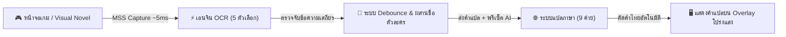

# TranGL-Releases
Public Releases

# 🌐 TranGL — Real-Time Screen OCR & Game Translation Overlay

> **Next-Generation Real-Time Screen OCR & Game Translation Overlay for Windows**  
> TranGL captures text from games, visual novels, emulators, or screen regions in real-time (~5ms capture), extracts text using 5 specialized OCR engines (including zero-install Windows Media OCR and high-speed PaddleOCR ONNX), and translates it using 9 cloud/local translation providers directly onto a click-through transparent HUD overlay.

---

### 📑 Quick Language Navigation / สารบัญเลือกภาษา
- 🇬🇧 **[English Documentation](#-english-documentation)**
  - [✨ Key Features](#-key-features)
  - [👑 Freemium Model (Lite vs Pro VIP)](#-freemium-model-lite-vs-pro-vip)
  - [⚡ OCR Engines & Translators](#-5-multi-engine-ocr-technologies)
  - [💾 Downloads & Installation](#-downloads--quick-start)
  - [⌨️ Global Hotkeys](#️-global-hotkeys)
  - [📁 Project Structure & Ecosystem](#-project-structure--ecosystem)
- 🇹🇭 **[คู่มือการใช้งานภาษาไทย (Thai Documentation)](#-คู่มือการใช้งานภาษาไทย-trangl-thai-documentation)**
  - [🌟 ภาพรวมและจุดเด่นของโปรแกรม](#-ภาพรวมและจุดเด่นของโปรแกรม)
  - [👑 สิทธิประโยชน์รุ่นฟรี (Lite) vs สมาชิกรายเดือน (Pro VIP)](#-สิทธิประโยชน์-รุ่นใช้งานฟรี-lite-vs-สมาชิกรายเดือน-pro-vip)
  - [⚡ เอนจิน OCR ทั้ง 5 ตัว และผู้ให้บริการแปล 9 ค่าย](#-เอนจิน-ocr-ทั้ง-5-ตัว-และผู้ให้บริการแปลภาษา-9-ค่าย)
  - [🚀 การดาวน์โหลดและการเริ่มต้นใช้งาน](#-การดาวน์โหลดและการเริ่มต้นใช้งานด่วน)
  - [🎮 เทคนิคการแปลเกมภาษาไทย](#-ฟีเจอร์เด่นเพื่อการแปลเกมภาษาไทยที่สมบูรณ์แบบ)
  - [⌨️ ตารางปุ่มลัด (Hotkeys)](#️-ตารางปุ่มลัดควบคุมทั้งหมด-global-hotkeys)
  - [🌐 ระบบเว็บสมาชิกและชุมชน Discord](#-ระบบเว็บสมาชิก-trangl-web-portal-และชุมชน)

---

# 🇬🇧 English Documentation

## ✨ Key Features

- **Multi-Region Screen OCR**: Draw and manage multiple simultaneous OCR capture boxes with independent settings and speaker/dialogue roles.
- **Ultra-Fast Frame Capture (~5ms)**: Uses high-performance `mss` capture optimized with per-thread instances (`threading.local`) and fast pixel diff / pHash change detection (skips ~80–90% of redundant OCR & API cycles).
- **5 Specialized OCR Engines**: Windows Native Media OCR (WinRT, 0-install), PaddleOCR (PP-OCRv4 ONNX, ~16ms), Portable Tesseract OCR, Manga-OCR (ViT ONNX on-demand), and Ollama Vision.
- **9 Cloud & Local Translation Providers**: Google Translate (Free), MyMemory (Free), DeepL, OpenAI (ChatGPT / GPT-4o), Gemini 2.0 Flash, Claude 3.5, DeepSeek, Groq (Ultra-fast Llama-3.3 70B), and Ollama / Custom LLM (OpenRouter).
- **Smart Game Dialogue Intelligence**:
  - *Typewriter Debouncer*: Intelligently waits for character typewriter animations to complete before invoking translation.
  - *Speaker & Dialogue Priority Merge*: Automatically parses character names (`speaker`) and merges them into dialogue context for natural pronoun translation.
  - *AI Prompt Presets*: Switch translation tone on the fly (`standard`, `vn_story`, `wuxia_fantasy`, `adult_18`).
- **Continuous Thai Text Auto-Wrapping & Outline**: Automatic line breaking for Thai script without spaces (`TextWordWrap | TextWrapAnywhere`), auto-fitting font sizes, and customizable text outlines for readable overlay text on any game background.
- **Backlog & Dialogue History**: Dedicated conversation history window with live search, character tagging, and CSV / TXT export.
- **Modern Theme & Frameless UI**: Full Dark Mode & Light Mode styling with polished controls, WCAG AA contrast standards, and customized System Tray menu.
- **Ultra-Lean Distribution Footprint**: Unpacked standalone build is only **~284 MB**, Portable Zero-Install ZIP is **~125 MB**, and Windows Setup Installer is **~109 MB**.

---

## 👑 Freemium Model: Lite vs Pro VIP

TranGL is distributed under a **Freemium + Pro VIP Monthly Subscription** model. The Free Lite edition is free for life with essential features, while Pro VIP unlocks unlimited power for serious story-driven gamers.

| Feature Area | 🟢 TranGL Lite (Free Lifetime) | 👑 TranGL Pro VIP (Monthly Subscription) |
| :--- | :---: | :---: |
| **Max OCR Regions** | Up to **2 simultaneous regions** | **Unlimited simultaneous regions** |
| **Speaker-Dialogue Merge** | Disabled (independent regions) | **Automatic speaker name + dialogue context merge** |
| **Available OCR Engines** | Windows OCR (Built-in) + Tesseract | + **PaddleOCR (ONNX)**, **Manga-OCR (ONNX)**, **Ollama Vision** |
| **Available Translators** | Google Translate (Free), MyMemory | + **Gemini, Claude, OpenAI, DeepSeek, Groq, DeepL, Ollama** |
| **AI Prompt Presets** | `standard` only | + **`vn_story` (JRPG/VN)**, **`wuxia_fantasy` (Wuxia)**, **`adult_18` (Uncensored)** |
| **Glossary Terms** | Up to **10 custom terms** | **Unlimited terms** + Regex pattern rules + JSON Import/Export |
| **Character Personas** | Up to **2 trial characters** | **Unlimited characters** (custom gender, pronouns & persona tones) |
| **Game Profiles** | Default + **1 custom profile** | **Unlimited per-game profiles** & community sharing |
| **Backlog History** | Latest **10 dialogue entries** | **Unlimited history review**, full search, CSV / TXT export |
| **VIP Community & Presets** | Public support channels | **Discord VIP role** + direct access to pre-made game dictionaries |

---

## ⚡ 5 Multi-Engine OCR Technologies

1. **Windows OCR (WinRT - Built-in)**: Uses Microsoft Windows 10/11 native Media OCR APIs. Works immediately out of the box with zero external dependencies or downloads.
2. **PaddleOCR (RapidOCR ONNX Runtime)**: High-speed, highly accurate deep learning OCR (~16ms inference) utilizing ONNX Runtime and automatic contrast/inversion preprocessing.
3. **Tesseract OCR**: Portable bundled engine (~31.7 MB stripped MinGW runtime) or system-installed Tesseract.
4. **Manga-OCR (ViT ONNX On-Demand)**: Specialized Vision Transformer model for Japanese vertical manga text, stylized fonts, and complex illustrations. Model files (~111 MB) automatically download on first activation and cache permanently for offline use.
5. **Ollama Vision**: Multimodal vision-language model OCR (e.g. `gemma4:12b`, `llama3.2-vision`) running 100% locally on your machine.

---

## 🌐 9 Multi-Tier Translation Providers

1. **Google Translate**: Free, unlimited, out-of-the-box translation.
2. **MyMemory**: Free fallback translation memory service.
3. **DeepL**: Industry-leading natural language translation via user DeepL API key.
4. **OpenAI**: GPT-4o, GPT-4o-mini, and GPT-3.5-turbo models with system prompt injection.
5. **Gemini**: Google's fast, high-accuracy `gemini-2.0-flash` model.
6. **Claude**: Anthropic's `claude-3-5-haiku` and `claude-3-5-sonnet` for literary fluency.
7. **DeepSeek**: High-performance, cost-effective translation via `deepseek-chat`.
8. **Groq**: Ultra-low-latency LPU inference running `llama-3.3-70b-versatile` (~200ms roundtrip).
9. **Ollama / Custom LLM**: 100% offline local translation via Ollama (`qwen2.5`, `gemma4`) or any OpenRouter / OpenAI-compatible endpoint.

---

## 💾 Downloads & Quick Start

### Option 1: Pre-built Windows Releases (Recommended for Users)

- 📦 **[TranGL-Portable.zip] (~125 MB): Zero installation required. Simply download, extract to any folder, and run `TranGL.exe`. Portable mode stores all settings in the local folder.
- 💿 **[TranGL-Setup.exe] (~109 MB): Official Windows Installer with desktop shortcuts, uninstaller, and Start Menu integration.

### 🎮 Basic Usage Guide

1. **Draw Regions**: Click `⬜ Draw Region` in the Control Panel or press `Ctrl+Shift+R`.
2. **Drag & Select**: Click and drag your mouse across on-screen game text areas. Assign a role (`dialogue` or `speaker`).
3. **Confirm**: Press `Enter` to confirm your selection (or `Esc` to cancel).
4. **Start Scanning**: Click `▶ Start` or press `Ctrl+Shift+S`. Translated text will appear seamlessly on the click-through HUD overlay!
5. **Translate Once**: Press `Ctrl+Shift+S` twice or trigger single-shot translation from the tray icon for static visual novel scenes.

---

## ⌨️ Global Hotkeys

All hotkeys work globally while in-game without losing window focus:

| Hotkey | Action | Description |
|:---:|:---|:---|
| `Ctrl+Shift+T` | **Toggle Overlay** | Hide or show the transparent translation overlay |
| `Ctrl+Shift+S` | **Start / Stop Scanning** | Immediately toggle real-time OCR and translation |
| `Ctrl+Shift+R` | **Draw New Regions** | Open full-screen screen selection tool |
| `Ctrl+Shift+C` | **Toggle Control Panel** | Show, hide, or restore main settings control panel |
| `Ctrl+Shift+H` | **Toggle Backlog History** | Open dialogue backlog window with search and CSV/TXT export |
| `Ctrl+Shift+I` | **Toggle Click-Through** | Enable or disable mouse interaction passing through overlay |
| `Ctrl+Shift+D` | **Toggle Debug HUD** | Display OCR timing, translation latency, and cache hits |

---

 

---

# 🇹🇭 คู่มือการใช้งานภาษาไทย (TranGL Thai Documentation)

## 🌟 ภาพรวมและจุดเด่นของโปรแกรม

**TranGL (แทรน-จีแอล)** คือโปรแกรมแปลภาษาบนหน้าจอแบบเรียลไทม์ (Real-Time Screen OCR & Game Translation Overlay) ที่ออกแบบมาเพื่อเกมเมอร์และนักแปลชาวไทยโดยเฉพาะ พัฒนาขึ้นด้วยภาษา Python 3.11+ และ PyQt6 สามารถตรวจจับข้อความในเกม, Visual Novel, เกมจำลอง (Emulator), หรือโปรแกรมใดๆ บนหน้าจอ และแสดงคำแปลภาษาไทยทับบนตำแหน่งเดิมทันทีด้วยหน้าต่างโปร่งแสง (Click-through HUD Overlay) โดยไม่บดบังการคลิกเมาส์หรือการควบคุมเกม

### จุดเด่นที่เหนือกว่าโปรแกรมแปลเกมทั่วไป
1. **ตัดบรรทัดภาษาไทยอัตโนมัติ (Continuous Thai Word Wrap)**: หมดปัญหาภาษาไทยที่แปลจาก Google หรือ AI ติดกันเป็นพืดยาวแล้วทะลุกรอบ ด้วยระบบตัดคำคู่ขนาน `TextWordWrap | TextWrapAnywhere`
2. **ระบบหน่วงเวลาตัวอักษรพิมพ์ดีด (Typewriter Debouncer)**: เกม Visual Novel หรือ RPG ที่ตัวอักษรค่อยๆ วิ่งทีละตัว โปรแกรมจะฉลาดพอที่จะรอจนประโยคพิมพ์เสร็จก่อนแปล ไม่เปลืองโควตาและไม่แปลกระตุก
3. **ระบบผสานชื่อผู้พูดเข้ากับบทสนทนา (Speaker Dialogue Priority Merge)**: แปลชื่อตัวละครร่วมกับบทพูด ทำให้ AI เข้าใจบริบทว่าใครกำลังพูดกับใคร สรรพนาม (ฉัน/เธอ/ข้า/เจ้า) จึงถูกต้องเป็นธรรมชาติ
4. **เอนจิน OCR 5 ตัวเลือก**: มี **Windows OCR ในตัว** ที่ไม่ต้องลงโปรแกรมเพิ่ม และ **PaddleOCR ONNX** ที่เร็วเพียง ~16ms ตรวจจับตัวหนังสือคมชัดแม้ฉากหลังมืดหรือสว่าง
5. **ขนาดไฟล์กะทัดรัด**: ตัวโปรแกรมถูกปรับแต่งโครงสร้างอย่างประณีต ตัวติดตั้งเหลือเพียง **~109 MB** และแบบพกพา (Portable) เพียง **~125 MB** เปิดใช้งานได้ทันทีโดยไม่เปลืองพื้นที่เครื่อง

---

## 👑 สิทธิประโยชน์: รุ่นใช้งานฟรี (Lite) vs สมาชิกรายเดือน (Pro VIP)

TranGL ให้บริการในรูปแบบ **Freemium** โดยมีรุ่นใช้งานฟรีตลอดชีพ (Lite) สำหรับผู้เล่นทั่วไป และรุ่นสมาชิกรายเดือน (Pro VIP) สำหรับผู้เล่นสายเนื้อเรื่องที่ต้องการพลังการแปลขั้นสูง:

| รายการฟีเจอร์ / สิทธิประโยชน์ | 🟢 TranGL Lite (ฟรีตลอดชีพ) | 👑 TranGL Pro VIP (สมาชิกรายเดือน) |
| :--- | :---: | :---: |
| **จำนวนกรอบแปลหน้าจอ (OCR Regions)** | สูงสุด 2 กรอบ | **ไม่จำกัดจำนวนกรอบ** |
| **การรวมชื่อตัวละครกับบทพูด (Speaker Merge)** | แยกกรอบอิสระ (ไม่รวมชื่อ) | **ผสานชื่อตัวละครเข้ากับบทพูดอัตโนมัติ** |
| **เอนจิน OCR ที่ใช้งานได้** | Windows OCR (Built-in) + Tesseract | ปลดล็อก **PaddleOCR (ONNX)**, **Manga-OCR (ฟอนต์ญี่ปุ่น)**, **Ollama Vision** |
| **ระบบแปลภาษา (Translators)** | Google Translate (ฟรี) + MyMemory | ปลดล็อก **Gemini, Claude, OpenAI, DeepSeek, Groq, DeepL, Ollama** |
| **พรีเซ็ตสไตล์คำแปล AI (Prompt Presets)** | โหมดทั่วไป (Standard) | ปลดล็อก **VN Story (นิยาย/JRPG)**, **Wuxia Fantasy (จีนกำลังภายใน)**, **Adult 18+ (เกมผู้ใหญ่)** |
| **คลังคำศัพท์เฉพาะเกม (Glossary)** | บันทึกได้สูงสุด 10 คำ | **ไม่จำกัดคำ** + เปิดใช้ **Regex Pattern** + **นำเข้า/ส่งออก JSON** |
| **ระบบเพศและสรรพนามตัวละคร (Personas)** | ทดลองตั้งค่าได้ 2 ตัวละคร | **ไม่จำกัดจำนวนตัวละคร** (คุมคำแทนตัวเองและคำเรียกคู่สนทนาแม่นยำ) |
| **ประวัติบทสนทนาย้อนหลัง (Backlog)** | ดูย้อนหลังได้ 10 ประโยคล่าสุด | **ดูย้อนหลังได้ไม่จำกัด** + ส่งออกประวัติเป็นไฟล์ CSV / TXT |
| **โปรไฟล์แยกตามเกม (Game Profiles)** | ค่าเริ่มต้น + บันทึกเพิ่มได้ 1 โปรไฟล์ | **บันทึกโปรไฟล์แยกเกมได้ไม่จำกัด** และแชร์ให้เพื่อนได้ |
| **การสนับสนุนและสิทธิพิเศษ** | ห้องพูดคุยสาธารณะ | **สิทธิ์เข้าห้อง Discord VIP + คลังพรีเซ็ตคำศัพท์เกมยอดนิยมฟรี** |

---

## ⚡ เอนจิน OCR ทั้ง 5 ตัว และผู้ให้บริการแปลภาษา 9 ค่าย

### 🔍 เอนจินตรวจจับตัวอักษร (OCR Engines)
- **Windows OCR (WinRT - Built-in)**: ทำงานทันทีบน Windows 10/11 ไม่ต้องติดตั้งโปรแกรมเพิ่ม แม่นยำ รวดเร็ว และกินทรัพยากรเครื่องน้อยมาก
- **PaddleOCR (RapidOCR ONNX Runtime)**: เอนจิน Deep Learning ประสิทธิภาพสูงพิเศษ (~16ms) ตรวจจับตัวอักษรได้แม่นยำสูงแม้ฉากหลังเกมจะซับซ้อน
- **Tesseract OCR**: เอนจินมาตรฐานระดับสากล มีชุด Portable บันเดิลแถมไปพร้อมใช้งานทันที (รองรับภาษาอังกฤษ ญี่ปุ่น และไทย)
- **Manga-OCR (ViT ONNX On-Demand)**: สุดยอดเอนจิน AI สำหรับการ์ตูนมังงะและเกมญี่ปุ่นที่มีฟอนต์แฟนซีหรือตัวอักษรแนวตั้ง (ดาวน์โหลดโมเดล ~111 MB อัตโนมัติเมื่อเปิดใช้ครั้งแรก)
- **Ollama Vision**: สำหรับผู้ที่ต้องการใช้โมเดล Vision ในเครื่องตัวเอง เช่น `gemma4:12b` หรือ `llama3.2-vision` แบบออฟไลน์ 100%

### 🌐 ระบบแปลภาษา (Translation Providers)
- **Google Translate**: ฟรี ใช้งานได้ทันที ไม่จำกัดคำ เหมาะสำหรับการเล่นเกมทั่วไป
- **MyMemory**: ระบบแปลสำรองฟรี ใช้งานได้โดยไม่ต้องใส่คีย์
- **DeepL API**: ผู้นำด้านการแปลภาษาที่เป็นธรรมชาติที่สุด (รองรับ Free API Key)
- **Gemini (Google AI)**: แปลได้รวดเร็ว สละสลวย และราคาประหยัดมากผ่านโมเดล `gemini-2.0-flash`
- **Claude (Anthropic)**: ภาษาไทยระดับงานวรรณกรรม ถ่ายทอดอารมณ์ตัวละครได้ยอดเยี่ยม (`claude-3-5-haiku` / `sonnet`)
- **OpenAI (ChatGPT)**: แม่นยำตามคำสั่ง รองรับโมเดล `gpt-4o-mini` และ `gpt-4o`
- **DeepSeek**: แปลฉลาด คุ้มค่า และเข้าใจสำนวนภาษาเอเชียได้ดีเยี่ยมผ่าน `deepseek-chat`
- **Groq**: แปลไวสายฟ้าแลบด้วยชิป LPU (~200ms) ผ่านโมเดล `llama-3.3-70b-versatile`
- **Ollama / Custom LLM**: แปลออฟไลน์ในเครื่องตัวเองโดยไม่ต้องต่อเน็ต หรือเชื่อมต่อไปยัง OpenRouter / API อื่นๆ

---

## 🚀 การดาวน์โหลดและการเริ่มต้นใช้งานด่วน

### ดาวน์โหลดไฟล์โปรแกรมสำเร็จรูป (แนะนำสำหรับผู้ใช้ทั่วไป)

1. ดาวน์โหลดไฟล์รุ่นล่าสุดจากโฟลเดอร์
   - 📦 **[TranGL-Portable.zip] (~125 MB): รุ่นพกพา ไม่ต้องติดตั้ง แตกไฟล์ ZIP แล้วดับเบิลคลิก `TranGL.exe` เล่นได้ทันที
   - 💿 **[TranGL-Setup.exe] (~109 MB): ตัวติดตั้งมาตรฐาน มี Shortcut บนหน้าจอ Desktop และเมนูถอนการติดตั้ง
2. เปิดโปรแกรม **TranGL** จากนั้นทำตาม 4 ขั้นตอนง่ายๆ:
   - **ขั้นตอนที่ 1 (ลากกรอบ)**: กดปุ่ม `⬜ Draw Region` หรือกด `Ctrl+Shift+R` แล้วลากเมาส์คลุมพื้นที่ข้อความในเกม (กำหนดให้เป็น `dialogue` สำหรับบทพูด หรือ `speaker` สำหรับชื่อตัวละคร)
   - **ขั้นตอนที่ 2 (ยืนยัน)**: กดปุ่ม `Enter` เพื่อบันทึกตำแหน่งกรอบ
   - **ขั้นตอนที่ 3 (เริ่มแปล)**: กดปุ่ม `▶ Start` หรือกด `Ctrl+Shift+S` เพื่อเริ่มการแปลแบบเรียลไทม์
   - **ขั้นตอนที่ 4 (เพลิดเพลินกับเกม)**: คำแปลจะปรากฏซ้อนทับตำแหน่งเดิมบนหน้าจอทันที สามารถคลิกเมาส์ทะลุตัวหนังสือได้ตามปกติ!

---

## 🎮 ฟีเจอร์เด่นเพื่อการแปลเกมภาษาไทยที่สมบูรณ์แบบ

### 1. การตัดบรรทัดภาษาไทยอัตโนมัติ (Continuous Thai Word Wrap)
ภาษาไทยไม่มีช่องว่างระหว่างคำเหมือนภาษาอังกฤษ หากโปรแกรมทั่วไปแสดงผล ตัวหนังสือมักทะลุล้นกรอบ TranGL ใช้ระบบคำนวณความกว้างตัวอักษรแบบ DirectWrite ร่วมกับแฟล็ก `TextWordWrap | TextWrapAnywhere` และระบบ **Auto-Fit Font Size** ช่วยย่อขนาดฟอนต์ให้พอดีกับกรอบโดยอัตโนมัติ

### 2. ขอบตัวอักษรอ่านง่าย (Text Outline Styling)
คุณสามารถปรับขนาดเส้นขอบตัวอักษร (Text Outline) และสีของขอบได้ที่เมนูตั้งค่า เพื่อให้สามารถอ่านคำแปลภาษาไทยได้อย่างชัดเจนบนทุกพื้นหลังของเกม ไม่ว่าจะเป็นฉากหิมะสีขาวหรือฉากกลางคืนในดันเจี้ยน

### 3. คลังคำศัพท์เฉพาะเกม (Glossary) & เพศตัวละคร (Character Personas)
- **Glossary**: ล็อกคำแปลเฉพาะ เช่น ชื่อเมือง, ชื่อไอเทม, หรือท่าไม้ตาย เพื่อไม่ให้ AI แปลเพี้ยนเป็นคำอื่น
- **Character Personas**: กำหนดว่าตัวละครตัวนี้เป็น "ผู้หญิง / อายุมากกว่า / อ่อนหวาน" หรือ "ผู้ชาย / ดุดัน / กษัตริย์" เพื่อให้ AI แปลคำสรรพนาม (ฉัน, ข้า, ท่าน, นายท่าน) ได้ตรงตามบทบาทของเกม

### 4. พรีเซ็ตสไตล์คำแปล AI (Prompt Presets)
- **Standard**: ภาษาทางการ สุภาพ เหมาะกับเกมวางแผนหรือเกมทั่วไป
- **VN Story**: ภาษาลื่นไหล โรแมนติก ดราม่า ถ่ายทอดอารมณ์แบบเกม Visual Novel และ JRPG
- **Wuxia Fantasy**: สำนวนแนวนิยายจีนกำลังภายใน ยุทธภพ กำลังภายใน พลังปราณ
- **Adult 18+**: โหมดเกมผู้ใหญ่ แปลเนื้อหาตรงไปตรงมา ไม่ตัดทอนบทสนทนาอารมณ์

---

## ⌨️ ตารางปุ่มลัดควบคุมทั้งหมด (Global Hotkeys)

ปุ่มลัดของ TranGL สามารถกดใช้งานได้ทันทีขณะที่กำลังเล่นเกมอยู่ โดยไม่ต้องสลับหน้าจอ (Alt+Tab):

| ปุ่มลัด (Hotkey) | คำสั่งการทำงาน | หน้าที่ |
|:---:|:---|:---|
| `Ctrl+Shift+T` | **Toggle Overlay** | ซ่อน / แสดง หน้าต่างโปร่งแสงแสดงคำแปล |
| `Ctrl+Shift+S` | **Start / Stop Scanning** | เริ่ม / หยุด การสแกนหน้าจอและแปลภาษาแบบเรียลไทม์ทันที |
| `Ctrl+Shift+R` | **Draw New Regions** | เข้าสู่โหมดลากตีกรอบพื้นที่หน้าจอใหม่ |
| `Ctrl+Shift+C` | **Toggle Control Panel** | ซ่อน / แสดง แผงควบคุมการตั้งค่าหลัก |
| `Ctrl+Shift+H` | **Toggle Backlog History** | เปิด / ปิด หน้าต่างประวัติบทสนทนาย้อนหลัง ค้นหา และส่งออกข้อมูล |
| `Ctrl+Shift+I` | **Toggle Click-Through** | สลับโหมดคลิกเมาส์ทะลุหน้าต่างคำแปล (เปิด/ปิด) |
| `Ctrl+Shift+D` | **Toggle Debug HUD** | แสดงตัววัดเวลา Latency ความเร็ว OCR และเวลาที่ใช้ในการแปล |

